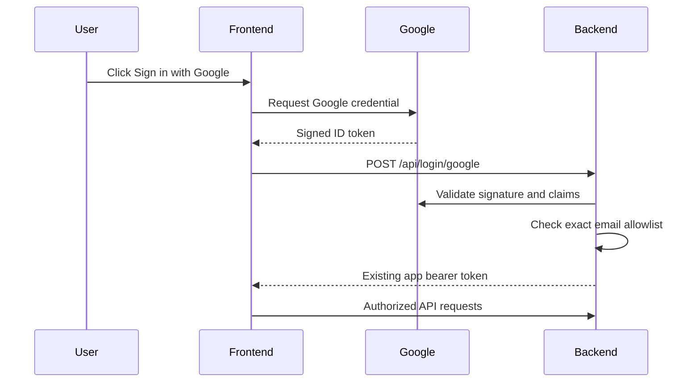

# Google authentication with authorized-email access

Replace the primary admin sign-in with Google Identity Services, enforce an exact-email allowlist on the Go backend, and retain the current password login only as a clearly separated emergency fallback. Document local Docker and Railway/Google Cloud setup with copyable placeholders and verification steps.

## Target design

Use Google only to prove who the person is; the backend remains the authority that decides whether that email may administer the app.

The Google client secret is not needed for this browser ID-token flow. The Google client ID is public; `ADMIN_SECRET` and the fallback password remain private.

## 1. Refactor backend authentication

- Update [backend/internal/service/auth.go](backend/internal/service/auth.go) so `Auth` receives:
  - a Google token-verifier interface (injectable for tests),
  - `GOOGLE_CLIENT_ID`,
  - a normalized, exact-email allowlist,
  - existing fallback username/password,
  - a stable app-token signing secret.
- Add Google credential verification using the official `google.golang.org/api/idtoken` package. Require a valid signature, issuer, expiry, exact audience, nonempty email, and `email_verified=true`.
- Sign app sessions with the authentication method and principal (`google:<email>` or `password:<username>`). Re-check Google users against the allowlist whenever a session token is read, so removing an email blocks its existing session immediately. Reject legacy/unknown token formats.
- Preserve 12-hour app sessions, but keep authorization entirely server-side; the frontend must never be trusted to enforce the allowlist.
- Add the dependency to [backend/go.mod](backend/go.mod) and [backend/go.sum](backend/go.sum).

## 2. Separate Google and emergency-password endpoints

- In [backend/internal/api/auth.go](backend/internal/api/auth.go):
  - add `POST /api/login/google` accepting `{ "credential": "<Google ID token>" }`,
  - retain `POST /api/login` for `{ "username": "...", "password": "..." }` as the emergency fallback,
  - return the same `{ username, token }` session shape from both,
  - apply a small request-body limit and generic unauthorized errors so account/allowlist details are not disclosed.
- Register the Google endpoint in [backend/internal/api/server.go](backend/internal/api/server.go).
- Continue protecting all write endpoints with the existing bearer-token checks.

## 3. Make configuration fail closed

- Update [backend/cmd/main.go](backend/cmd/main.go) to read:
  - `GOOGLE_CLIENT_ID` — the Web OAuth client ID,
  - `AUTHORIZED_EMAILS` — comma-separated exact Google email addresses,
  - `ADMIN_USER` / `ADMIN_PASSWORD` — emergency fallback credentials,
  - `ADMIN_SECRET` — a persistent, randomly generated signing secret.
- Refuse to start when Google client ID, allowlist, or `ADMIN_SECRET` is missing. Permit the password fallback to be disabled by leaving `ADMIN_PASSWORD` empty.
- Normalize allowlisted emails by trimming whitespace and lowercasing; reject an empty resulting list.

## 4. Replace the primary frontend form with Google sign-in

- Add `@react-oauth/google` to [frontend/package.json](frontend/package.json) and generate/update the lockfile.
- Wrap the application in `GoogleOAuthProvider` in [frontend/src/index.js](frontend/src/index.js), using `REACT_APP_GOOGLE_CLIENT_ID`.
- Update [frontend/src/Login.js](frontend/src/Login.js):
  - show “Sign in with Google” as the primary action,
  - send the returned credential to the backend,
  - show friendly messages for cancelled Google sign-in, denied access, and server/network failures,
  - retain the username/password fields in a clearly labeled, collapsed “Emergency admin login” section.
- Update [frontend/src/api.js](frontend/src/api.js) with separate `loginWithGoogle(credential)` and `loginWithPassword(username, password)` functions. Keep the existing app bearer token/session/logout behavior.

## 5. Add automated coverage and API documentation

- Expand [backend/internal/service/auth_test.go](backend/internal/service/auth_test.go) with a fake Google verifier covering allowed email, unauthorized email, wrong audience, unverified email, invalid/expired credential, case normalization, allowlist removal, fallback login, malformed/legacy app token, and expiry.
- Expand [backend/internal/api/auth_test.go](backend/internal/api/auth_test.go) for both login endpoints, malformed/oversized bodies, generic 401 responses, and session validation.
- Update [backend/internal/api/openapi.json](backend/internal/api/openapi.json) with the Google request schema, fallback endpoint, bearer security declarations, and error responses.
- Run Go tests, a frontend production build, and focused manual login/logout/expired-session checks.

## 6. Configure Google Cloud step by step

Document these exact beginner steps in [README.md](README.md):

1. Open Google Cloud Console and create/select a project.
2. Open Google Auth Platform, configure Branding, and choose the audience. For personal Gmail accounts use External; while in testing, add each intended Google account as a test user.
3. Create an OAuth client of type **Web application**.
4. Add authorized JavaScript origins only (no redirect URI is needed):
   - `http://localhost:3000`
   - the exact production frontend origin, for example `https://your-app.up.railway.app`
   Origins must contain scheme and host only—no path, `/lista`, trailing route, or wildcard.
5. Copy the generated client ID ending in `.apps.googleusercontent.com`. Do not create or configure a client secret for this flow.
6. Explain testing versus publishing the consent configuration and note that basic identity scopes do not grant access to Gmail/Drive data.

## 7. Configure local Docker and Railway

- Update [docker-compose.yml](docker-compose.yml) with placeholders for `GOOGLE_CLIENT_ID`, `AUTHORIZED_EMAILS`, `ADMIN_SECRET`, and strong fallback credentials; pass `REACT_APP_GOOGLE_CLIENT_ID` to the frontend build/runtime.
- Update [frontend/Dockerfile](frontend/Dockerfile) so the CRA production build receives `REACT_APP_GOOGLE_CLIENT_ID` as a build argument/environment variable.
- In [README.md](README.md), provide copyable setup instructions:
  - use the same Google client ID in frontend and backend,
  - set `AUTHORIZED_EMAILS=user1@gmail.com,user2@example.com`,
  - generate `ADMIN_SECRET` with `openssl rand -base64 48` and never rotate it casually,
  - set a unique high-entropy `ADMIN_PASSWORD` because the fallback remains enabled,
  - configure these as Railway service variables, then redeploy the backend and rebuild/redeploy the frontend,
  - never commit real secrets or passwords.
- Include a final verification checklist: allowed Google account succeeds; non-allowlisted account receives 401; password fallback succeeds; removing an email invalidates its app session; logout and protected write operations behave correctly.
